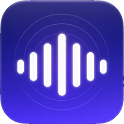

  

<h1 align="center">Sidetone</h1>

Hear your own mic through your headphones, from the macOS menu bar.

  <a href="https://github.com/MylesShannon/sidetone/releases/latest">Download</a> ·
  <a href="#faq">FAQ</a> ·
  <a href="docs/development.md">Build from source</a>

Sidetone sends any input to whatever output you pick. Usually that means hearing
your own microphone while you talk, but a line-in works just as well. It lives in
the menu bar and keeps out of the way.

It works with any pair of devices. A USB mic into Bluetooth headphones trips up
most tools like this, because the two run on slightly different clocks and the
audio slowly falls apart. Sidetone handles that pair, and it keeps working if you
leave it on all day.

"Sidetone" is what phone engineers call the bit of your own voice they feed back
into the earpiece. Without it, people shout.

## Features

- Any input to any output: a microphone, a line-in or anything else the Mac sees
  as an input, into headphones or speakers.
- Gain in dB that ramps as you drag, a mute button, a level meter, and a spectrum
  so you can see sound arriving.
- A low cut, bass and treble, and presets for the devices and settings you use most.
- `⌥⌘M` starts and stops monitoring from any app, with an optional hold-to-mute key.
- Follows the system default devices, so putting headphones on moves monitoring to
  them.
- Warns about feedback before you send a microphone to the built-in speakers.
- Stops and tells you when a device goes missing, and starts again when it comes
  back.
- Checks for new versions and asks before installing one.

## Install

You need macOS 15 or later.

Download the DMG from the
[latest release](https://github.com/MylesShannon/sidetone/releases/latest), open
it and drag Sidetone into Applications. It's signed and notarized by Apple, so it
opens like any other app. If you open it from anywhere else, such as the DMG, it
offers to move itself there with **Move to Applications**, because it can only open
at login and update itself from Applications.

To build it from source instead, run `./install.sh` on a Mac with Xcode or the
Command Line Tools. [Development](docs/development.md) has the details.

macOS asks for microphone access the first time you start monitoring, and asks
about notifications when Sidetone first launches. Notifications are only used to
tell you when monitoring stops on its own, so it is safe to refuse.

## Using it

Click the waveform in the menu bar, pick an input and an output, then flip the
switch. Use headphones. Through the built-in speakers your mic hears itself and
howls, and Sidetone will say so before you try it. The gear at the bottom of the
panel opens Settings, and so does opening Sidetone again while it's running.

- The slider sets gain in dB. It ramps as you drag, so it won't click.
- The meter shows your level, and the bars below it show the frequencies, so you
  can see whether anything is arriving.
- `⌥⌘M` starts and stops monitoring from any app. You can add a **Hold to mute**
  key in Settings, under **Shortcuts**.
- Latency sits in the panel. **Low** is the tightest, and **Automatic** picks a
  setting for your devices. If the audio starts breaking up, Sidetone raises the
  buffer on its own and says so.
- Leave a picker on **System default** and Sidetone follows whatever macOS is
  using, so putting headphones on moves monitoring to them.
- Tone controls sit in Settings, under **Audio**: a **Low cut** for rumble, and
  **Bass** and **Treble** either side of it.
- Save a pair of devices, the gain and the tone as a preset in Settings, under
  **Presets**.
- Unplug something and monitoring stops and tells you what went missing. Plug it
  back in and it starts again. Switch on **Start monitoring when your devices are
  plugged in** under **General** and it also starts on its own when your devices
  appear.
- The menu bar icon fills in while monitoring, shows a slash while muted, and
  turns into a warning triangle when monitoring fails or the microphone is off.
- If macOS needs your approval before Sidetone can open at login, Settings says so
  under **General**, and **Open Login Items Settings** takes you there.
- Sidetone checks for new versions and offers to install them. It asks first, and
  you can turn off **Check for updates automatically** in Settings.

### Not just microphones

Anything the Mac sees as an input works, which makes Sidetone useful for getting
sound out of a device that has nowhere to send it.

The case it gets used for most: a games console feeding the monitor's
picture-in-picture input, with the console's audio going into a USB line-in on the
Mac. Monitors play sound from their main input only, so the console picture appears
in the corner of the screen with no audio at all. Point Sidetone at the line-in and
send it to the monitor's speakers, and the console can be heard while the Mac keeps
the main picture.

Two things help here. The gain slider goes to +48 dB, because a line-in can arrive
quieter than you would like. And Sidetone knows a line input can't hear the room,
so it won't warn you about feedback when you send it to speakers, which it would if
you were using a microphone.

## How it works

Most monitoring tools route the input to the output through a single stream, which
drifts and eventually crackles once the two devices run on different clocks.
Sidetone runs capture and playback separately, joined by a buffer, and resamples
the audio by at most half a percent to keep that buffer at a steady level. That is
far below where a change in pitch is audible.

Capture doesn't open an output device of its own, so it can't push a Bluetooth
headset into its low quality headset mode. The latency figure in the panel is an
estimate added up from the devices' reported latencies and buffer sizes, not a
measurement.

[Architecture](docs/architecture.md) covers the audio path in detail.

## FAQ

### Why can't I hear anything?

Check that the meter moves. If it doesn't, the input isn't sending anything. If
Sidetone says it needs microphone access, click **Open Settings** in the panel and
switch on Sidetone in the list that opens. Sidetone notices within a couple of
seconds, without a restart, and starts monitoring if you had switched it on.

### Why does the audio crackle or break up?

The buffer is too small for your devices. Pick a higher latency in the panel, such
as **High**. Sidetone also raises the buffer on its own when it notices the audio
breaking up.

### How do I uninstall Sidetone?

If you switched on **Open Sidetone at login**, switch it off in Settings first.
Then quit Sidetone and drag it from Applications to the Trash. Its settings and
presets stay, so a reinstall picks up where you left off. To remove them too, run
`defaults delete com.mshannon.sidetone`.

If you built it from source, `./uninstall.sh` switches off **Open Sidetone at
login**, removes the app and resets its microphone access. Add `--delete-settings`
to remove its settings and presets too.

## Credits and license

The icon came from an image model. The small glyphs in the app are Apple's SF
Symbols. Everything else is written from scratch.

MIT, see [LICENSE](LICENSE) and [NOTICE](NOTICE). This is a personal project and
isn't connected to any employer.
